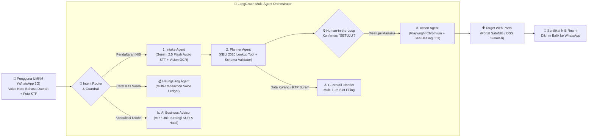

# SatuAkses — Multi-Agent Web-Bridge & Asisten UMKM via WhatsApp untuk Daerah Minim Sinyal (2G/3T)

**Agentic AI Hackathon ITB Series 2026**  
**Fokus Isu Keberlanjutan:** Teknologi Digital, Konektivitas Inklusif & Pemberdayaan Ekonomi UMKM  

🌐 **Live Production Demo (Google Cloud Run):**  
- **SatuAkses Command Center:** [https://satuakses-49024015367.us-central1.run.app](https://satuakses-49024015367.us-central1.run.app)  
- **Portal SatuNIB Pemerintah (Simulasi Target):** [https://satuakses-49024015367.us-central1.run.app/portal](https://satuakses-49024015367.us-central1.run.app/portal)

---

## 1. Latar Belakang Masalah & Pengguna Target
Jutaan pelaku UMKM mikro dan warga di wilayah 3T atau daerah dengan keterbatasan sinyal internet (jaringan 2G/EDGE tidak stabil) serta perangkat berspesifikasi rendah kesulitan mengakses layanan digital esensial seperti pendaftaran **Nomor Induk Berusaha (NIB)**, pembukuan keuangan harian, dan konsultasi pengembangan usaha.

Portal e-Government modern umumnya berukuran **> 4 MB** (penuh aset visual dan JavaScript berat), sering mengalami *timeout* saat sinyal lemah, serta memiliki navigasi formulir berlapis dan klasifikasi KBLI 5 digit yang membingungkan warga desa. Sementara itu, lebih dari **98% pengguna internet Indonesia** sudah terbiasa menggunakan **WhatsApp**, termasuk fitur pesan suara (*voice note*) berbahasa daerah.

---

## 2. Solusi & Arsitektur Multi-Agent (SatuAkses)
**SatuAkses** adalah ekosistem **Multi-Agent Web-Bridge & AI Business Assistant** yang memungkinkan pelaku UMKM mikro menuntaskan perizinan portal web kompleks, mencatat buku kas harian, hingga berkonsultasi strategi usaha cukup dengan mengirimkan **Pesan Suara (Bahasa Daerah/Indonesia)** dan **Foto KTP** melalui WhatsApp berkuota ultra-rendah (~52 KB, **hemat >98% kuota data**).



### Tiga Agen Inti & Ekosistem Retensi UMKM (`agents.py` & `browser_worker.py`):
1. **Intake Agent (`run_intake_agent`)**:
   - Menerima rekaman suara langsung (*voice note* Bahasa Sunda/Jawa/Indonesia) dan foto KTP.
   - Menggunakan **Google Gemini 2.5 Flash Multimodal (Vertex AI / GenAI SDK)** untuk mentranskripsikan audio bahasa daerah ke Bahasa Indonesia formal sekaligus mengekstrak NIK 16 digit, Nama, TTL, Alamat, Nama Usaha, dan Modal Usaha ke dalam `Structured JSON`.
2. **Planner Agent (`run_planner_agent`)**:
   - Memanggil tool **`lookup_kbli_tool`** untuk memetakan deskripsi usaha informal (misal: *"bikin keripik singkong"*, *"bengkel motor"*) ke kode resmi **KBLI 2020 (5 Digit)** beserta tingkat risikonya.
   - Memvalidasi kelengkapan skema formulir. Jika foto KTP buram atau ada field yang belum disebut, agen **menghentikan eksekusi browser** (menghemat kuota & komputasi) dan mengaktifkan **Multi-Turn Slot Filling**.
   - Menerapkan **Human-in-the-Loop (LangGraph Interrupt)**: mengirimkan ringkasan data ke WhatsApp dan menunggu otorisasi eksplisit (`"SETUJU"`) sebelum mengeksekusi browser.
3. **Action Agent (`run_action_agent` & `execute_playwright_portal_automation`)**:
   - Menjalankan **Playwright Chromium** di sisi server untuk membuka portal tujuan (`/portal`), mengisi formulir multi-tahap (Tahap 1 Identitas, Tahap 2 KBLI & Usaha), mencentang pernyataan mandiri, dan menerbitkan **Sertifikat NIB**.
   - Dilengkapi mekanisme **Self-Healing & Checkpoint Auto-Retry** ketika server portal tujuan mengalami gangguan (`HTTP 503 Service Unavailable`).
4. **HitungUang Cashflow Agent & AI Business Advisor (Retensi Pasca-NIB)**:
   - **Buku Kas Suara UMKM:** Mengubah satu pesan suara menjadi beberapa baris transaksi pemasukan dan pengeluaran terstruktur beserta kalkulasi laba bersih dan margin usaha.
   - **Konsultasi Usaha Kontekstual:** Menghitung estimasi HPP per unit, rekomendasi harga jual & paket bundling, kesiapan pengajuan KUR Mikro & Sertifikasi Halal Gratis (SEHATI), serta membuat draf promosi WhatsApp Story otomatis.

---

## 3. Penanganan Edge Cases & Safety Guardrails
SatuAkses dirancang tahan uji terhadap berbagai kondisi nyata di lapangan:
- **Pengiriman Ganda dengan Identitas Berbeda (*Conflict of Identity*):**
  - *Dalam sesi yang sama (koreksi):* Menerapkan hierarki prioritas `Gemini Live Baru -> Regex Baru -> Memori Sesi Lama`. Identitas atau KTP baru yang dikirimkan otomatis meng-overwrite data lama tanpa merusak slot data lain yang masih relevan.
  - *Sesi pemohon baru:* Setiap input kustom baru menginisiasi `session_id` terisolasi sehingga data antar-pemohon tidak pernah tercampur (*zero cross-contamination*).
- **Zero-Hallucination Policy:** Jika pengguna hanya mengirim suara tanpa KTP atau belum menyebut modal/alamat, sistem tidak pernah mengarang data fiktif. Field dibiarkan kosong dan memicu *Multi-Turn Slot Filling*.
- **Guardrail KTP Buram / Silau:** Deteksi kualitas visual otomatis; jika NIK tidak terbaca utuh 16 digit, alur dihentikan sementara dan pengguna diminta mengirim foto ulang atau mengetik NIK manual.
- **Human-in-the-Loop Gate:** Mencegah kesalahan fatal pada database pemerintah dengan mewajibkan konfirmasi `"SETUJU"` dari pengguna.
- **Self-Healing HTTP 503:** Exponential backoff & auto-retry pada Playwright saat portal pemerintah *overload*.

---

## 4. Tech Stack Modern
- **AI & Agentic Framework:** Google Gemini 2.5 Flash Multimodal (`google-genai` SDK via Vertex AI ADC / API Key), LangGraph State Machine.
- **Browser Automation:** Playwright Chromium (Headless & Headed mode support).
- **Backend:** FastAPI, Uvicorn, Python 3.12/3.13, Pillow.
- **Frontend Command Center:** React 18, Vite, Tailwind CSS, **Motion.dev** (`motion/react` spring transitions), **Anime.js** (SVG real-time packet visualizer), **Bklit UI** (Linear dark glassmorphism aesthetic), Web Audio API (`AudioContext` live volume meter & `MediaRecorder`).
- **Cloud Infrastructure:** Docker Container, Google Cloud Run (`us-central1`).

---

## 5. Panduan Demo Cepat untuk Juri (5 Skenario + Input Kustom Live)
Buka **[https://satuakses-49024015367.us-central1.run.app](https://satuakses-49024015367.us-central1.run.app)** dan gunakan tombol skenario di bagian atas layar:

1. **🟢 1. Alur Utama + HITL:** Simulasi Ibu Sari mengirim KTP + Voice Note bahasa Sunda $\rightarrow$ Ekstraksi & Pemetaan KBLI `10794` $\rightarrow$ Interupsi **Human-in-the-Loop** $\rightarrow$ Klik **"Balas SETUJU & Jalankan Playwright"** $\rightarrow$ Browser mengisi form otomatis & mengirimkan Sertifikat NIB ke WhatsApp.
2. **🟡 2. Guardrail KTP Buram:** Simulasi Pak Asep mengirim foto KTP buram & data kurang $\rightarrow$ **Planner Agent** menahan browser dan meminta klarifikasi spesifik $\rightarrow$ Klik tombol **Balas Cepat** untuk melengkapi data secara *multi-turn*.
3. **🔴 3. Error 503 Auto-Retry:** Simulasi server portal pemerintah mengalami *overload* (`HTTP 503`) saat disubmit $\rightarrow$ **Action Agent** menangkap bukti layar error 503, menyimpan *checkpoint*, dan melakukan *auto-retry* hingga Sertifikat NIB terbit.
4. **🔵 4. Buku Kas Suara (HitungUang):** Simulasi UMKM mencatat penjualan harian & belanja bahan baku lewat pesan suara $\rightarrow$ Otomatis dipecah menjadi tabel jurnal kas dan kalkulasi margin laba bersih.
5. **🟣 5. Konsultasi Usaha AI:** Simulasi tanya-jawab strategi menghadapi kenaikan harga bahan baku $\rightarrow$ AI menghitung HPP unit, kelayakan KUR/Halal, dan draf caption promosi WhatsApp.
6. **🎙️ Input Kustom (Rekam Suara Mikrofon & Upload KTP):**
   - Klik tombol **Input Kustom** di bar atas atau **ikon mikrofon** di kolom chat WhatsApp.
   - Klik **"Mulai Rekam Suara"** (dilengkapi indikator gelombang suara *real-time* & timer), lalu klik **"Berhenti Merekam"**.
   - **Gemini 2.5 Flash** otomatis mentranskripsikan suara Anda ke kotak teks dan menyediakan pemutar audio preview sebelum dikirim ke Intake Agent.

---

## 6. Cara Menjalankan di Lokal & Deploy ke Cloud Run

### A. Menjalankan Secara Lokal
```bash
# 1. Install library Python
pip install -r requirements.txt

# 2. Install browser Chromium untuk Playwright
playwright install chromium

# 3. (Opsional) Build ulang Frontend React jika mengubah kode di folder frontend/
cd frontend
npm install
npm run build
cd ..

# 4. Konfigurasi environment (.env)
cp .env.example .env
# Isi GEMINI_API_KEY atau gunakan Google Cloud Vertex AI ADC (gcloud auth application-default login)

# 5. Jalankan server SatuAkses
python app.py
```
Akses di browser:
- **SatuAkses Command Center:** `http://127.0.0.1:8000`
- **Portal SatuNIB Simulasi:** `http://127.0.0.1:8000/portal`

### B. Deploy ke Google Cloud Run
```bash
gcloud run deploy satuakses \
  --source . \
  --region us-central1 \
  --project hackathon-primestep-11 \
  --allow-unauthenticated \
  --set-env-vars GOOGLE_CLOUD_PROJECT=hackathon-primestep-11,GOOGLE_CLOUD_LOCATION=us-central1,PLAYWRIGHT_HEADLESS=true
```

---

## 7. Transparansi Bagian Aktual vs Simulasi
- **Aktual (Berjalan Nyata 100%):** Orkestrasi status LangGraph (`Intake` $\rightarrow$ `Planner` $\rightarrow$ `Human-in-the-Loop` $\rightarrow$ `Action`), perekaman mikrofon & transkripsi audio/OCR menggunakan **Google Gemini 2.5 Flash Multimodal (Live Vertex AI)**, pencocokan database KBLI 2020, kalkulasi buku kas *HitungUang*, serta automasi browser **Playwright Chromium** yang mengisi DOM HTML multi-step dan mengambil *screenshot* nyata.
- **Simulasi:** Antarmuka WhatsApp disajikan dalam bentuk *Web Simulator* terintegrasi agar juri dapat mengamati *live agent trace*, perbandingan kuota 2G, dan *live browser view* dalam satu layar; serta portal target menggunakan **Portal SatuNIB Simulasi (`/portal`)** dengan KTP sintetis demi mematuhi regulasi pelindungan data pribadi (UU PDP).
