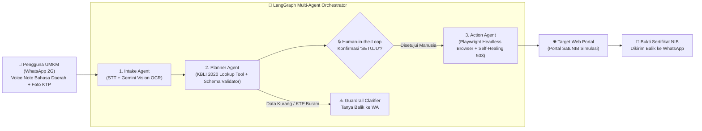

# SatuAkses — Multi-Agent Web-Bridge via WhatsApp untuk Daerah Minim Sinyal (2G/3T)

**Agentic AI Hackathon ITB Series 2026**  
**Fokus Isu Keberlanjutan:** Teknologi Digital dan Konektivitas

---

## 1. Latar Belakang Masalah & Pengguna Target
Jutaan pelaku UMKM mikro dan warga di daerah dengan keterbatasan sinyal internet (jaringan 2G/EDGE tidak stabil) serta perangkat berspesifikasi rendah kesulitan mengakses layanan digital penting seperti pendaftaran **Nomor Induk Berusaha (NIB)**, layanan administrasi publik, dan katalog pasar digital. Portal web modern umumnya berukuran **> 4 MB** (penuh aset visual dan JavaScript berat), sering mengalami *timeout* saat sinyal lemah, serta memiliki navigasi formulir berlapis yang membingungkan.

Sementara itu, lebih dari **98% pengguna internet Indonesia** aktif menggunakan **WhatsApp**, termasuk fitur pesan suara (*voice note*) berbahasa daerah.

---

## 2. Solusi & Arsitektur Multi-Agent (SatuAkses)
**SatuAkses** adalah sistem **Multi-Agent Web-Bridge** yang memungkinkan pelaku UMKM mikro menuntaskan perizinan portal web kompleks cukup dengan mengirimkan **Pesan Suara (Bahasa Daerah/Indonesia)** dan **Foto KTP** melalui WhatsApp berkuota rendah (~52 KB, **hemat >98% kuota data**).



### Tiga Agen Terorkestrasi (`agents.py` & `browser_worker.py`):
1. **Intake Agent (`run_intake_agent`)**:
   - Menerima pesan suara (Bahasa Sunda/Jawa/Indonesia) dan foto KTP.
   - Menggunakan **Google Gemini 2.5 Flash Multimodal API** untuk menerjemahkan bahasa daerah ke Bahasa Indonesia administrasi formal sekaligus mengekstrak NIK 16 digit, Nama, TTL, Alamat, Nama Usaha, dan Modal Usaha ke dalam `Structured JSON`.
2. **Planner Agent (`run_planner_agent`)**:
   - Memanggil tool **`lookup_kbli_tool`** untuk memetakan deskripsi usaha informal ke kode resmi **KBLI 2020 (5 Digit)** beserta tingkat risikonya.
   - Memvalidasi kelengkapan skema formulir. Jika foto KTP buram atau ada data kurang, agen **menahan eksekusi browser** (menghemat kuota & komputasi) dan bertanya balik ke pengguna.
   - Menerapkan **Titik Persetujuan Manusia (*Human-in-the-Loop* / LangGraph Interrupt)**: mengirimkan ringkasan data ke WhatsApp dan menunggu otorisasi eksplisit (`"SETUJU"`) sebelum mengeksekusi browser.
3. **Action Agent (`run_action_agent` & `execute_playwright_portal_automation`)**:
   - Menjalankan **Playwright Chromium** di sisi server untuk membuka portal tujuan (`/portal`), mengisi formulir multi-tahap (Tahap 1 Identitas, Tahap 2 KBLI & Usaha), mencentang pernyataan mandiri, dan menerbitkan **Sertifikat NIB**.
   - Dilengkapi mekanisme **Self-Healing & Checkpoint Auto-Retry** ketika server portal tujuan mengalami gangguan (`HTTP 503 Service Unavailable`) sehingga pengguna tidak perlu mengirim ulang data dari awal.

---

## 3. Cara Menjalankan Prototype

### Prasyarat & Dependensi
- Python 3.10+ (diuji pada Python 3.13 Windows)
- Dependensi utama: `fastapi`, `uvicorn`, `playwright`, `google-genai`, `langgraph`, `pillow`, `python-dotenv`, `requests`

### Langkah Instalasi & Menjalankan
```bash
# 1. Install library Python
pip install -r requirements.txt

# 2. Install browser Chromium untuk Playwright
playwright install chromium

# 3. Salin konfigurasi environment (.env)
cp .env.example .env
# Masukkan GEMINI_API_KEY Anda di dalam file .env

# 4. Jalankan server SatuAkses Command Center & Portal Simulasi
python app.py
```

Buka browser di:
- **SatuAkses 3-Panel Command Center (Demo Utama Juri):** `http://127.0.0.1:8000`
- **Portal SatuNIB Simulasi (Target Web):** `http://127.0.0.1:8000/portal`

---

## 4. Panduan Demo Cepat untuk Juri (Sesuai Rubrik Slide 11)
Di bagian atas halaman `http://127.0.0.1:8000`, tersedia **3 Tombol Skenario Juri**:
1. **🟢 Skenario 1 (Alur Utama + Human-in-the-Loop):** Simulasi Ibu Sari (Desa Sukamaju) mengirim KTP + Voice Note bahasa Sunda $\rightarrow$ Ekstraksi & Pemetaan KBLI `10794` $\rightarrow$ Interupsi **Human-in-the-Loop** $\rightarrow$ Klik **"Balas SETUJU & Jalankan Playwright"** $\rightarrow$ Browser mengisi form otomatis & mengirimkan gambar Sertifikat NIB ke WhatsApp.
2. **🟡 Skenario 2 (Kondisi Gagal 1 — KTP Buram / Data Kurang):** Simulasi Pak Asep mengirim foto KTP buram dan lupa menyebutkan nama/modal usaha $\rightarrow$ **Planner Agent** mendeteksi ketidaklengkapan, membatalkan pemanggilan browser, dan meminta klarifikasi spesifik.
3. **🔴 Skenario 3 (Kondisi Gagal 2 — Server Portal Error 503 & Auto-Retry):** Simulasi server portal tujuan mengalami *overload* (`HTTP 503`) saat disubmit $\rightarrow$ **Action Agent** menangkap layar error 503, menyimpan *checkpoint* data formulir, dan melakukan *auto-retry* hingga Sertifikat NIB terbit tanpa membebani kuota pengguna.

---

## 5. Bagian Simulasi vs Aktual (Transparansi Slide 11)
- **Aktual (Berjalan Nyata):** Orkestrasi status LangGraph (`Intake` $\rightarrow$ `Planner` $\rightarrow$ `Human-in-the-Loop` $\rightarrow$ `Action`), pemanggilan API Multimodal Gemini 2.5 Flash, pencocokan database KBLI 2020, serta automasi browser **Playwright Chromium** yang mengisi DOM HTML multi-step dan mengambil *screenshot* nyata.
- **Simulasi:** Antarmuka WhatsApp dibuat dalam bentuk *Web Simulator* terintegrasi agar juri dapat melihat perbandingan kuota & trace agen dalam satu layar, serta situs target menggunakan **Portal SatuNIB Simulasi (`/portal`)** dengan data KTP sintetis demi mematuhi aturan keamanan data pribadi (Slide 14).
